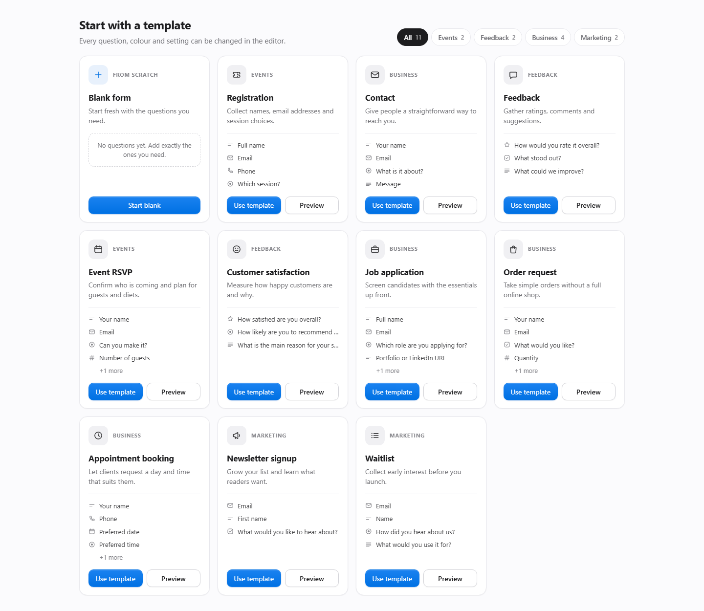
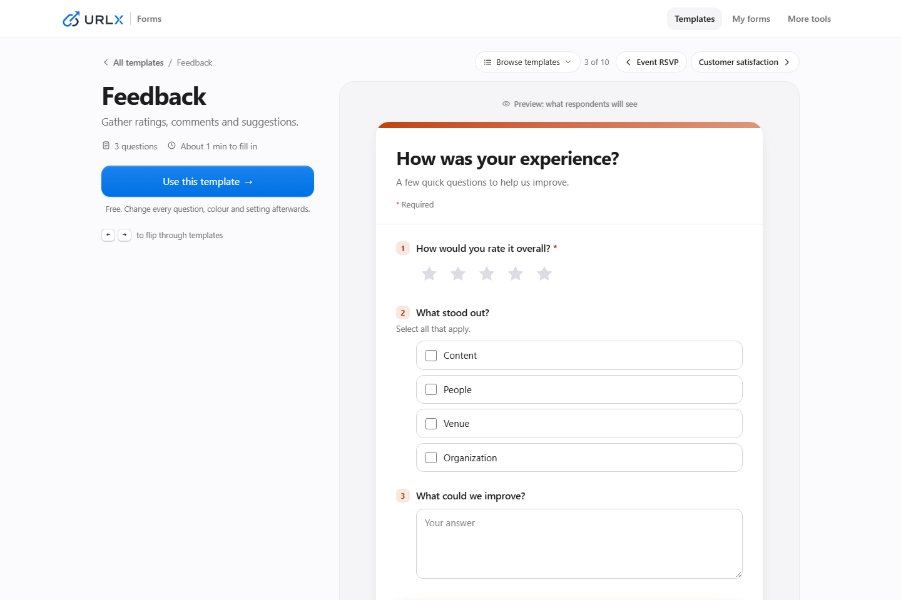
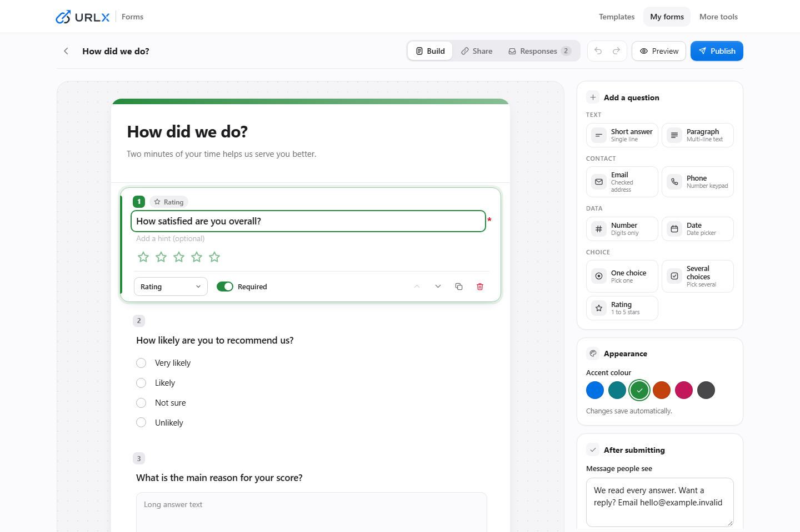
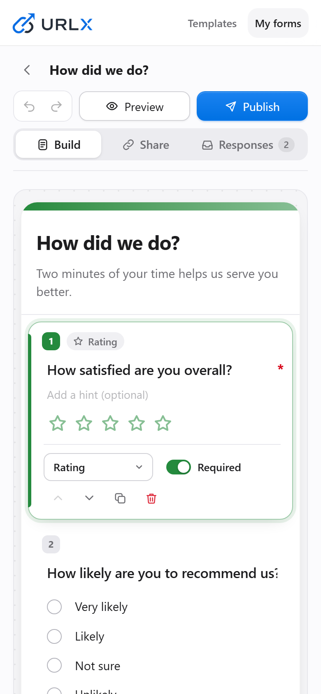
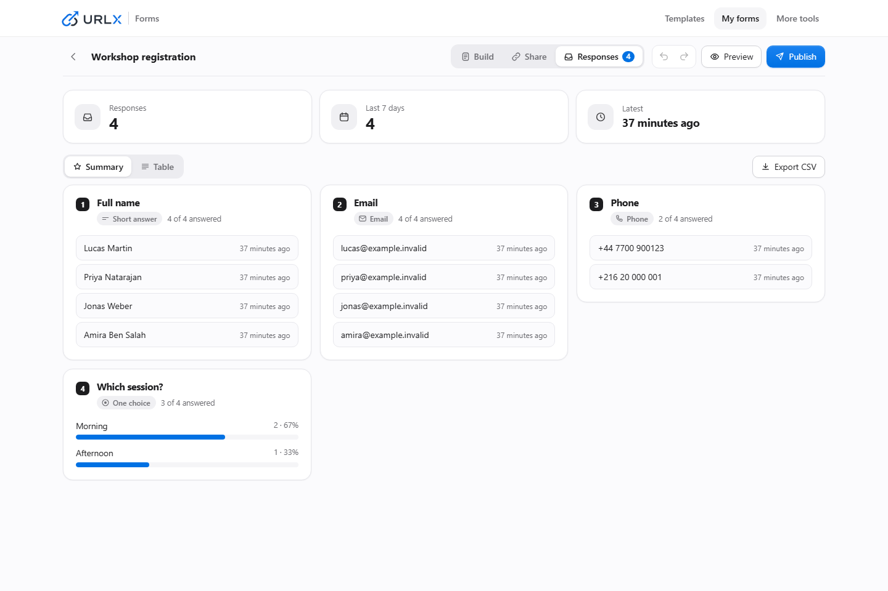
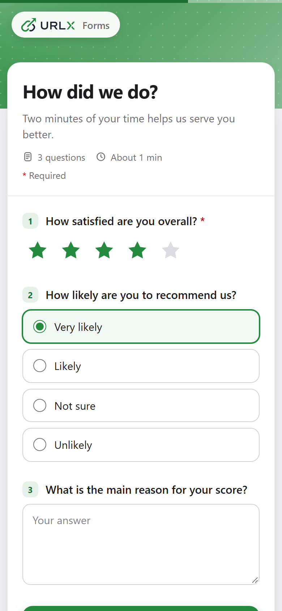
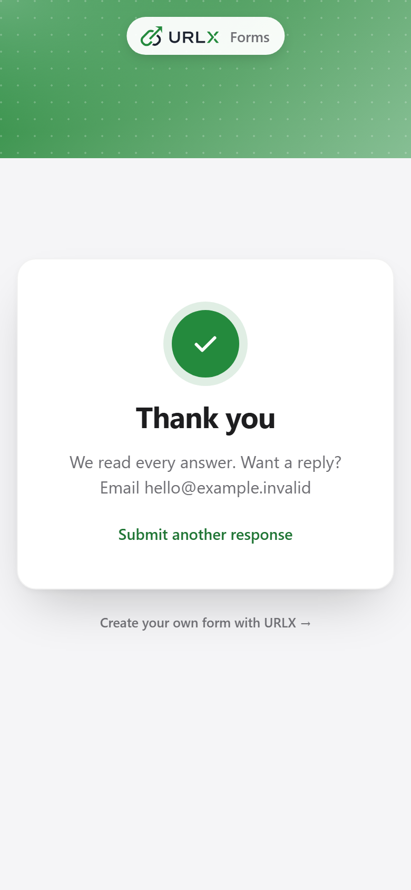

# URLX Forms setup

## Interface previews

These screenshots come from a local preview with synthetic data.

URLX Forms is part of the MIT-licensed URLX application. It is available when the
Forms authentication and email bindings are configured. Until then, the Forms
entry points are hidden and Forms API requests fail closed; existing URL tools
continue to run.

## Configure passwordless sign-in

Set these values in the deployment environment used by Alchemy. Keep the secret
and Resend key in the environment's encrypted secret store.

| Setting | Purpose |
| --- | --- |
| `BETTER_AUTH_SECRET` | Random Better Auth signing secret with at least 32 bytes of entropy |
| `BETTER_AUTH_URL` | Canonical HTTPS site origin, such as `https://urlx.tn` |
| `RESEND_API_KEY` | Resend API key used only to send sign-in links |
| `AUTH_EMAIL_FROM` | Sender address on a domain verified by Resend |

All four values are required to enable Forms. The server uses the same-origin
`/api/auth/*` path and host-only, secure, HTTP-only session cookies. Configure
the sender domain and DNS records in Resend before enabling the feature. Sign-in
links are single-use and time limited. Forms does not require a password or a
separate account registration step.

The Forms database migration is in `packages/db/src/migrations` and is included
by the existing D1 migration configuration. Apply it through the normal
reviewed database release process for the target environment. Do not use
`packages/db/drizzle.config.ts` for local Forms test data: it loads the root
`.env` and is configured for D1 HTTP access.

## Local development and tests

Forms must remain disabled unless all required bindings are explicitly supplied.
For development, start the API and web workers against a fresh, disposable
local D1 binding and a temporary persistence directory for each run. Apply only
committed migrations to that local binding and use synthetic users, forms,
responses, and captured test email. Never use an adopted/shared D1 database,
remote binding, production or shared development URL, or secrets from `.env*`
for tests. A local auth email adapter should capture links for tests and must
not report delivery when sending fails.

Bare Astro development proxies to `PUBLIC_SERVER_URL` only when it resolves to
`localhost`, `127.0.0.1`, or `::1`. Cloudflare deployments use the internal `API`
service binding. A missing or non-local API target returns 503.

## Limits and response retention

The current owner limits are 25 published forms, 1,000 accepted responses per
UTC month, 10,000 retained responses, and 50 fields per form. Request payloads
are limited to 64 KiB. Forms pause when a limit is reached; deleting a form does
not reduce the current month's accepted-response usage. Deleting retained
responses does not reset monthly usage. Response deletion and form deletion are
owner-only operations. Deleting a form purges its versions and retained response
data, releases its published-form slot, and preserves its monthly accepted count.
Historical slugs remain reserved as tombstones so a deleted form address cannot
be claimed by another owner.

The deployment's `form_limits` singleton row controls the published-form,
monthly-response, and retained-response caps. Operators can change its three
values for a deployment after reviewing the release; the D1 triggers read this
row as part of the atomic publish and response insert. Cloudflare applies a
per-IP limit of 30 public form renders and 10 submissions per minute. Bare
local development enforces the same limits in the server process. Both public
render and submit bodies are capped at 64 KiB from the actual stream, including
when a request omits or understates `Content-Length`.

Public forms use an immutable published version. Editing a draft does not alter
the live form; owners publish explicitly to change it. Historical submissions
remain grouped by the version that accepted them. The current and historical
form URLs resolve through the saved aliases, and the first short URL and QR
destination remain stable.
