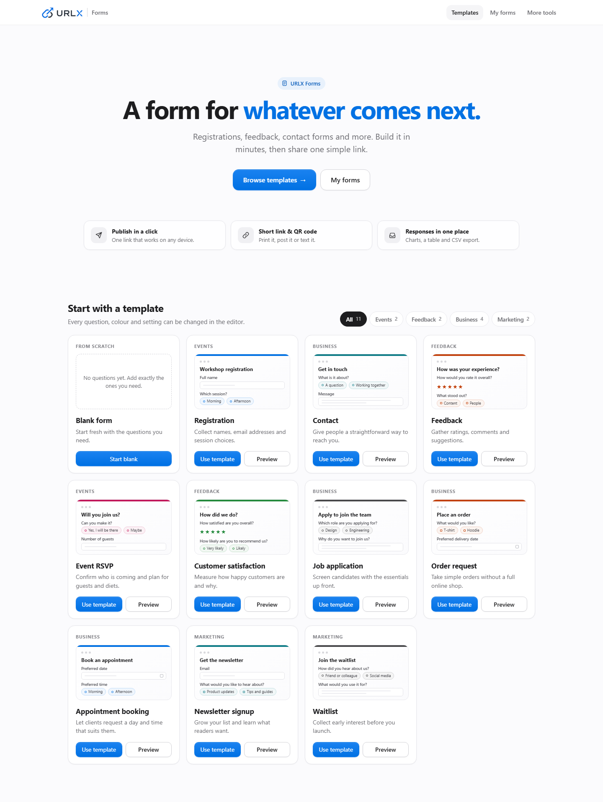
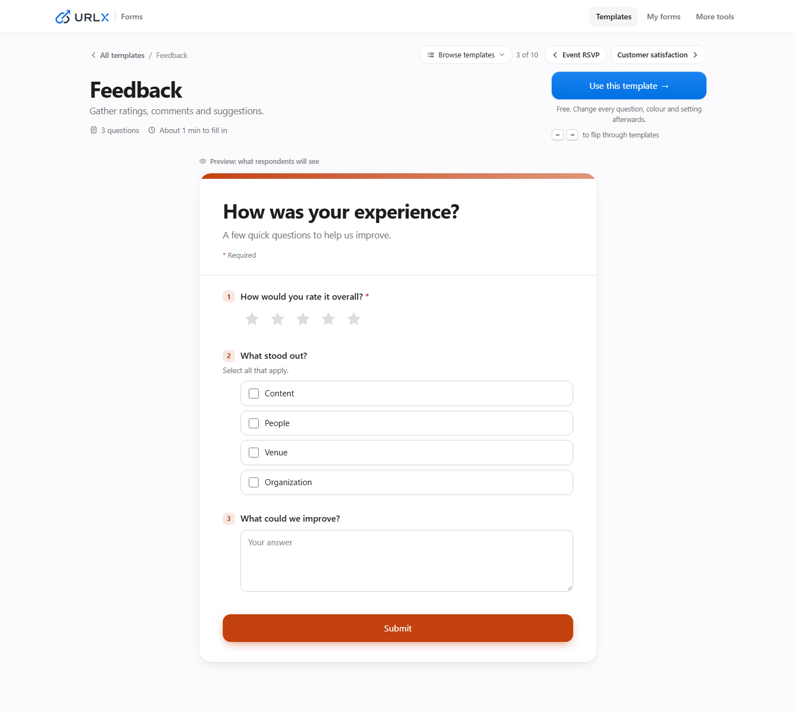
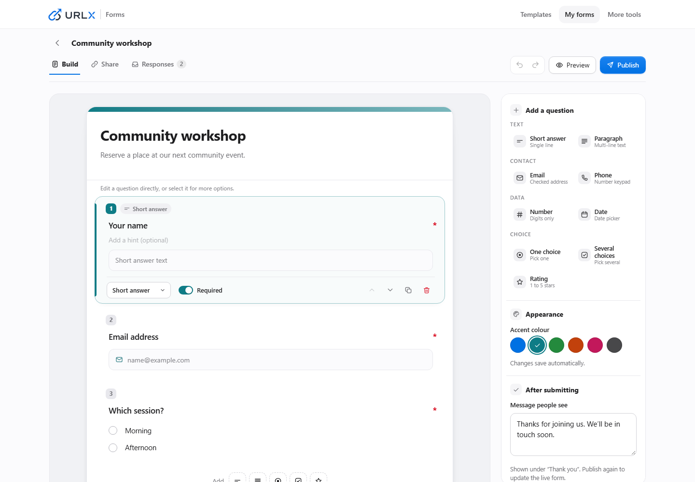
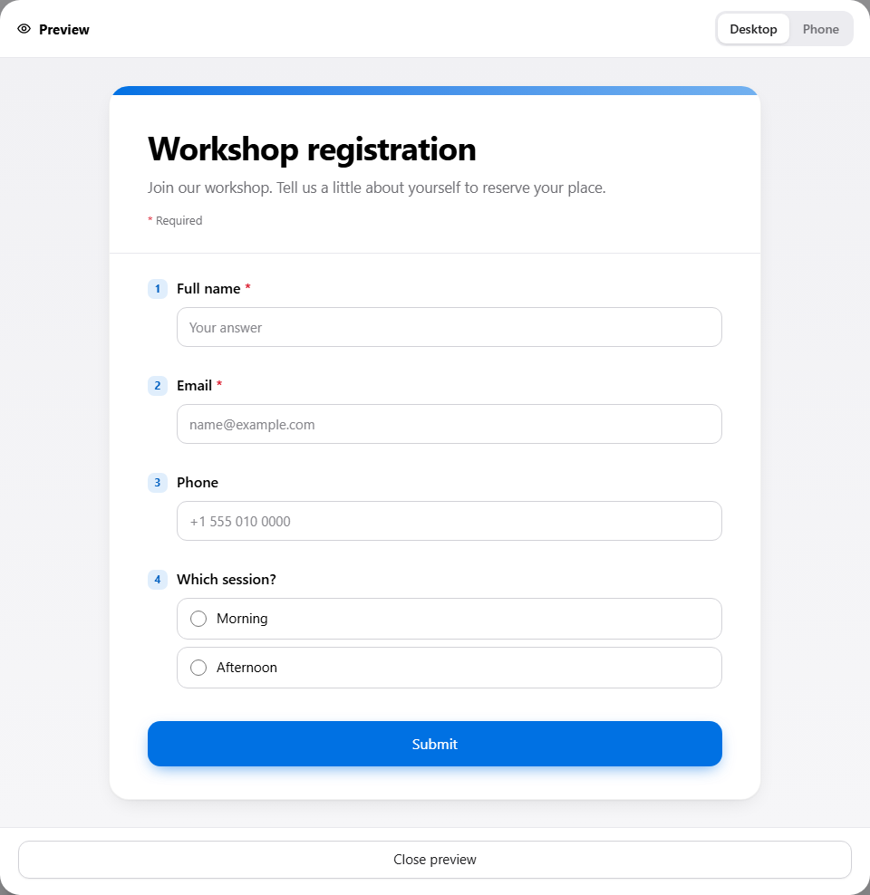
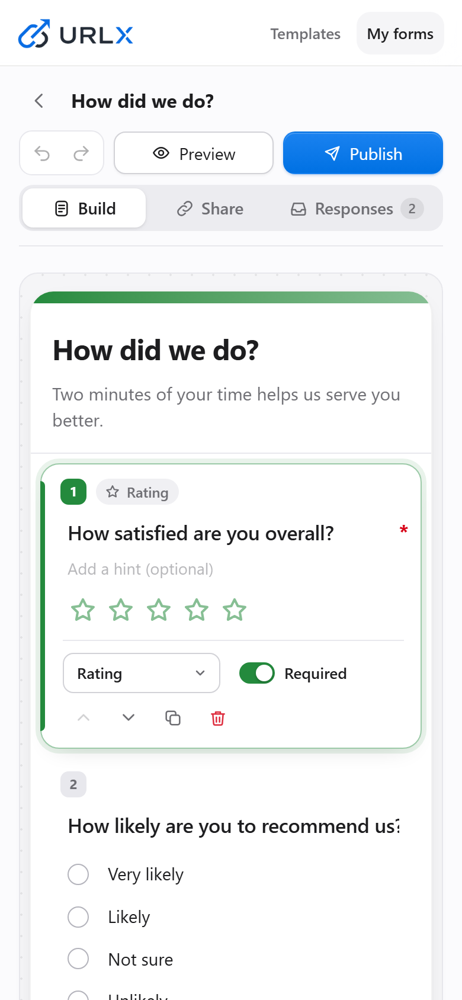
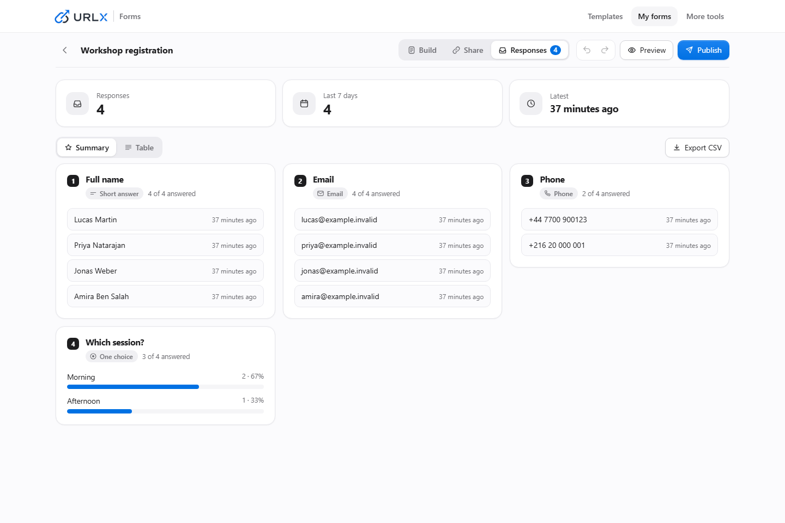
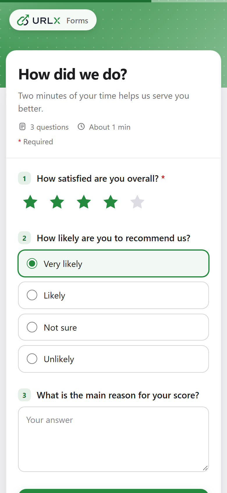
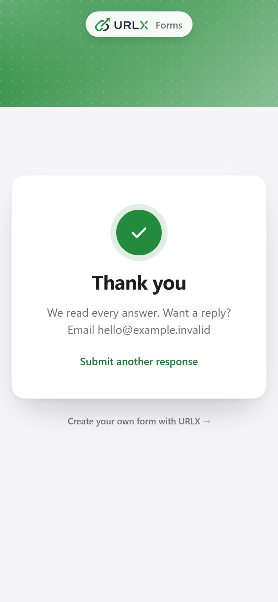

# URLX Forms setup

## Interface previews

These screenshots come from a local preview with synthetic data.

URLX Forms is part of the MIT-licensed URLX application. It is available when
the Forms authentication and email settings are configured. Until then, the
Forms entry points are hidden and Forms API requests fail closed; existing URL
tools continue to run.

## Configure passwordless sign-in

Set these values in the deployment environment. Keep the secret and Resend key
in the private `.env` file or deployment secret store.

| Setting | Purpose |
| --- | --- |
| `BETTER_AUTH_SECRET` | Random Better Auth signing secret with at least 32 bytes of entropy |
| `BETTER_AUTH_URL` | Canonical HTTPS site origin, such as `https://urlx.tn` |
| `RESEND_API_KEY` | Resend API key used only to send sign-in links |
| `AUTH_EMAIL_FROM` | Sender address on a domain verified by Resend |

All four values are required to enable Forms. The server uses the same-origin
`/api/auth/*` path and host-only, secure, HTTP-only session cookies. Configure
the sender domain and DNS records in Resend before enabling the feature. Sign-in
links are single-use and time limited. Forms does not require a password or a
separate account registration step.

The active Forms schema and migrations are PostgreSQL-backed and live in
`packages/db/src/schema` and `packages/db/src/migrations/pg`. Compose runs
`pnpm --filter @urlx/db db:migrate` with `MIGRATOR_DATABASE_URL` before starting
the API. The API receives only the restricted `urlx_app` database role.
Historical D1 migrations remain in the package as export/reference material.

## Local development and tests

For development and integration tests, use a fresh, disposable PostgreSQL
database and synthetic users, forms, responses, and captured test email. Never
use a production or shared database or credentials from another environment.
A local auth email adapter should capture links for tests and must not report
delivery when sending fails.

Bare Astro development proxies to `PUBLIC_SERVER_URL` only when it resolves to
`localhost`, `127.0.0.1`, or `::1`. Compose SSR uses the private
`INTERNAL_SERVER_URL`. A missing or non-local development API target returns
503.

## Respondent access

Every publish asks the creator to choose who may respond. **Anyone with the
link** keeps submissions anonymous. **Verified email required** asks respondents
to sign in with a one-time email link before viewing the questions or submitting;
the server checks the Better Auth session on both form render and submission.
Changing this choice takes effect when you publish; publishing again creates a
new version while preserving the earlier version's access policy. Existing
published versions migrate as public forms, so their links remain usable.

Verified email adds friction for casual abuse, but it does not guarantee that a
response is genuine or that bots cannot sign up. Public forms keep the existing
honeypot, signed submission token, request limits, payload validation, and owner
response quotas. Verified sign-in restricts who can open the form, but responses
are still anonymous to the form owner. Use operational review or an anti-bot
challenge for forms facing active spam.

## Limits and response retention

The current owner limits are 25 published forms, 1,000 accepted responses per
UTC month, 10,000 retained responses, and 50 fields per form. Request payloads
are limited to 64 KiB. Forms pause when a limit is reached; deleting a form does
not reduce the current month's accepted-response usage. Deleting retained
responses does not reset monthly usage. Response deletion and form deletion are
owner-only operations. Deleting a form purges its versions and retained response
data, releases its published-form slot, and preserves its monthly accepted count.
Historical slugs remain reserved as tombstones so a deleted form address cannot
be claimed by another owner.

The deployment's `form_limits` singleton row controls the published-form,
monthly-response, and retained-response caps. Operators can change its three
values after reviewing the release; PostgreSQL triggers enforce the atomic
publish and response-insert limits. Valkey applies shared per-IP limits for
public form renders and submissions. Bare local development uses the in-process
test adapter. Both public render and submit bodies are capped at 64 KiB from
the actual stream, including when a request omits or understates
`Content-Length`.

Public forms use an immutable published version. Editing a draft does not alter
the live form; owners publish explicitly to change it. Historical submissions
remain grouped by the version that accepted them. The current and historical
form URLs resolve through the saved aliases, and the first short URL and QR
destination remain stable.

CSV exports use one row per response field with fixed columns for the response,
version number and ID, submission time, field ID and label, and answer. Keeping
the version and label on each row preserves the meaning of answers when a field
changes between published versions without creating a wide matrix of mostly
empty columns. Multi-select answers are joined with semicolons in the answer
cell. Exports are paged with a start-of-export high-water mark, but concurrent
submissions or deletions can affect later pages; treat them as best-effort, not
as strict point-in-time snapshots.
